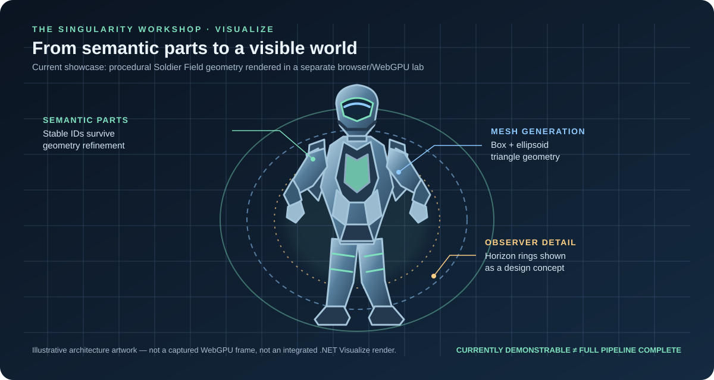

# Visual Primitives — From Meaning to Pixels

**Status:** Living guide. The Soldier Field browser lab currently demonstrates 3D mesh generation; the Primitive Gallery is an interactive SVG experiment that makes the early drawing progression visible. These are separate proof paths, not an integrated .NET rendering backend.



This artwork is part of the documentation, so readers can see the current visual direction without building or launching anything. It is an explanatory illustration—not a screenshot or proof of a connected production pipeline. The [Soldier Field guide](../samples/SoldierField/WebGpuRunner/README.md) describes the actual browser/WebGPU scene; the [Primitive Gallery](../samples/PrimitiveGallery/README.md) documents the interactive 2D experiment and its boundaries.

## 0. See the primitives, not just read about them

Open the [interactive SVG Primitive Gallery](../samples/PrimitiveGallery/index.html). It begins with one point, then lets you explore point clouds (including 10,000 marks), four connected points, one line, and many lines. Change the count, point size, line width, position spread, and colour style; randomize the point data and watch the element counts and local build-time observation update.

This is a **visual test sequence**, not yet an automated test of `TheSingularityWorkshop.Visualize`'s C# backend. It proves that the chosen SVG description is emitted and displayed by the browser. The current C# tests verify resource, frame, draw-range, and lifecycle contracts; they do not currently render these SVG examples. The page's build-time counter is a local DOM-generation observation, not a GPU benchmark or a cross-device performance claim.

## 1. One word, three different ideas

A *primitive* can mean different things at different layers. Keeping those meanings separate prevents a demo from accidentally defining the architecture.

| Layer | What a primitive means here | Example |
| --- | --- | --- |
| Domain / semantic part | A meaningful, stable piece of the object | `helmet.visor`, `torso.sternum-plate` |
| Geometry generator | A rule that produces triangles from a compact description | `box`, `ellipsoid` |
| Presentation backend | A way to turn prepared geometry into pixels | The current browser lab uses WebGPU |

A semantic part is not the same thing as a shape. The sternum plate is meaningful because of its role in the soldier; a box is only the current geometric approximation used to draw it. A later plate mesh, SVG outline, cutaway, or detailed model should be able to retain the same semantic identity.

## 2. Current geometry contract

The Soldier Field lab builds a deterministic vertex stream from a stable inventory of semantic parts:

- Coordinates are local to the soldier: **+Y is up, +Z is forward, +X is soldier-right**.
- Position values are expressed in nominal metres.
- Each vertex currently contains six `float32` values: position `(x, y, z)` and colour `(r, g, b)`.
- Vertices are emitted as a non-indexed triangle list.
- The generated array is a presentation asset, not authoritative world state.
- The manifest's stable part IDs are intended to survive geometry refinement, animation, damage, research, and alternate representations.

Implementation: [`soldier-geometry.js`](../samples/SoldierField/WebGpuRunner/soldier-geometry.js)  
Part inventory: [`soldier-geometry.json`](../samples/SoldierField/WebGpuRunner/soldier-geometry.json)  
Part engineering records: [`soldier-part-records.json`](../samples/SoldierField/WebGpuRunner/soldier-part-records.json)

## 3. Implemented mesh primitives

### Box

**Input:** center, dimensions, and colour.

The box generator creates six broad faces with chamfered edge strips and corner facets. This gives the current armor blockout visible planes for highlights while retaining a predictable, compact part description.

Used for such parts as boots, armor plates, the life-support pack, helmet visor, and weapon components.

**What this does not mean:** the resulting shape is not a manufacturing model, a certified engineering drawing, or a final bevelled CAD solid. Dimensions are nominal render-blockout values.

### Ellipsoid

**Input:** center, three radii, colour, and optional segment/ring counts.

The ellipsoid generator tessellates a parametric surface into triangles. Its segment and ring counts trade silhouette smoothness for vertex count. The helmet shell uses a deliberately higher tessellation than the default; shoulder hardpoints and joints use the same primitive with simpler defaults.

**Current limitation:** the implementation is a simple triangle surface generator. It is not a general-purpose mesh importer or a complete surface/material system.

## 4. How a part becomes visible

```text
Stable semantic part ID
          |
          v
Part description
(shape + transform + dimensions + material key)
          |
          v
Primitive generator
(box or ellipsoid)
          |
          v
Contiguous Float32Array
(position + colour per vertex)
          |
          v
WebGPU vertex buffer and draw
          |
          v
Browser canvas pixels
```

This describes the current Soldier Field sample path. It is **not** yet the end-to-end .NET Visualize contract: the C# resource/frame contracts and the browser JavaScript/WebGPU lab remain separate implementations. The browser lab currently uses a WebGPU canvas, not SVG, and does not execute the C# assembly inside the browser.

See [Visualizer Architecture](ARCHITECTURE.md) for the intended boundary between Renderer decisions, Visualize execution, and the host surface.

## 5. SVG is a different representation target

SVG represents visible geometry through a retained, document-shaped set of elements such as paths, rectangles, ellipses, and groups. The current WebGPU sample instead produces triangles in a GPU vertex buffer. These approaches can share semantic identity and source descriptions, but they are not interchangeable rendering backends by default.

The [Primitive Gallery](../samples/PrimitiveGallery/index.html) is the first visible SVG progression: point, point cloud, connected points, line, and line bundle. It demonstrates basic SVG construction and exposes DOM-generation observations. It does **not** yet project a Soldier Field semantic part into SVG, consume a Visualize C# frame, or establish a shared production rendering backend. See its [manual visual checks and run instructions](../samples/PrimitiveGallery/README.md).

A useful next experiment is to preserve one semantic part description and compare representations without changing the meaning of the part:

1. Keep the same stable part ID and source dimensions.
2. Produce the current 3D mesh representation.
3. Produce an SVG representation suitable for a chosen view, diagram, cut sheet, or schematic.
4. Compare what information each representation preserves and what must be discarded or derived.
5. Record the conversion rules and tests so an SVG is not mistaken for a full 3D object.

That experiment can help establish where Workshop C# libraries can author, transform, validate, or export SVG-related data, and where browser-specific JavaScript or a native host is still required. It should not claim that arbitrary C# executes inside an SVG document: that depends on the host/runtime and on the actual integration being built.

## 6. Primitive progression

Add primitives only when a real visualization needs them. For each addition, keep the following together:

- a small, inspectable input description;
- a deterministic generator or explicit conversion rule;
- a visible demonstration;
- automated tests for dimensions, topology or output shape, and invalid inputs;
- an explanation of the representation's limits;
- a note describing whether the primitive is semantic, geometric, or backend-specific.

Candidate investigations—not implemented primitives—include cylinders/capsules for actuators, indexed meshes for reusable geometry, and 2D SVG projections for diagrams and engineering cut sheets. Promote a candidate to “implemented” only when code and tests support the claim.

## 7. Related reading

- [Soldier Field scaling lab](../samples/SoldierField/WebGpuRunner/README.md) — run the current procedural 3D scene and read its measurement limits.
- [Architecture](ARCHITECTURE.md) — layer ownership and data flow.
- [GPU backend strategy](GPU_BACKEND_STRATEGY.md) — backend responsibilities and the exploratory browser/native directions.
- [Lighting and shadows](LIGHTING_AND_SHADOWS.md) — how visual work can be separated and scheduled.
