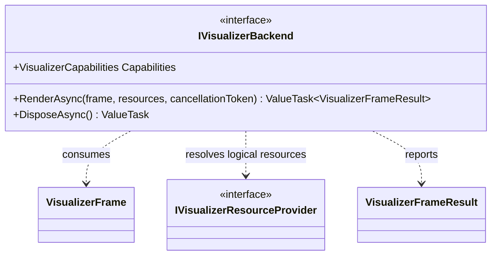

# UML — `IVisualizerBackend.cs`

**Source:** [`IVisualizerBackend.cs`](../../IVisualizerBackend.cs)

## Responsibility

Defines the asynchronous presentation boundary that consumes a Visualizer frame plus logical resource descriptions. A concrete implementation owns device resources and synchronization.

## Interface diagram

## Contract

- `Capabilities` reports the implementation's current feature snapshot.
- `RenderAsync` accepts an observer-relative frame and a logical resource provider.
- The optional cancellation token is documented to cancel work that has not yet been submitted to the device.
- `IAsyncDisposable` is the lifecycle boundary for backend-owned resources.

## Evidence limits

The interface alone does not demonstrate GPU output, synchronization correctness, device-loss handling, or production readiness. Each concrete backend requires separate tests and evidence. The existing GUI.SVG backend is explicitly a CPU-side SVG proof.
