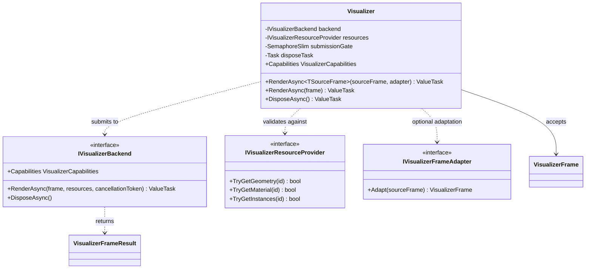

# UML — `Visualizer.cs`

**Source:** [`Visualizer.cs`](../../Visualizer.cs)

## Responsibility

`Visualizer` orchestrates frame submission. It validates each command's referenced geometry, material, index range, effective vertex indices, and optional instance range before forwarding the immutable frame to the configured backend. It does not itself render pixels.

## Class diagram

## Observed behavior

- Constructor rejects a null backend or resource provider.
- The semaphore serializes submissions and coordinates backend disposal with active submissions.
- A frame is rejected when a geometry/material/instance resource is missing or a requested range is invalid.
- `BaseVertex` is applied to each index value for effective vertex-range validation; it is not treated as an index-buffer offset.
- Disposal is idempotently represented by a cached task and disposes the backend after acquiring the submission gate.
- Cancellation is checked before validation/submission and passed to the backend. The backend contract documents cancellation as applying to work not yet submitted to the device.

## Boundaries and non-claims

- The class is orchestration, not a GPU implementation.
- Capability values come from the backend and are not universal promises.
- Correctness of backend resource lifetime and actual pixel output must be verified by the backend and its integration tests.

## Verification targets

See [Visualizer contract tests](../../tests/TheSingularityWorkshop.Visualize.Tests/VisualizerContractTests.cs) and the [GUI.SVG integration backend](../../integrations/GuiSvg/GuiSvgVisualizerBackend.cs). The latter is a CPU/SVG manifestation proof, not GPU rendering.
