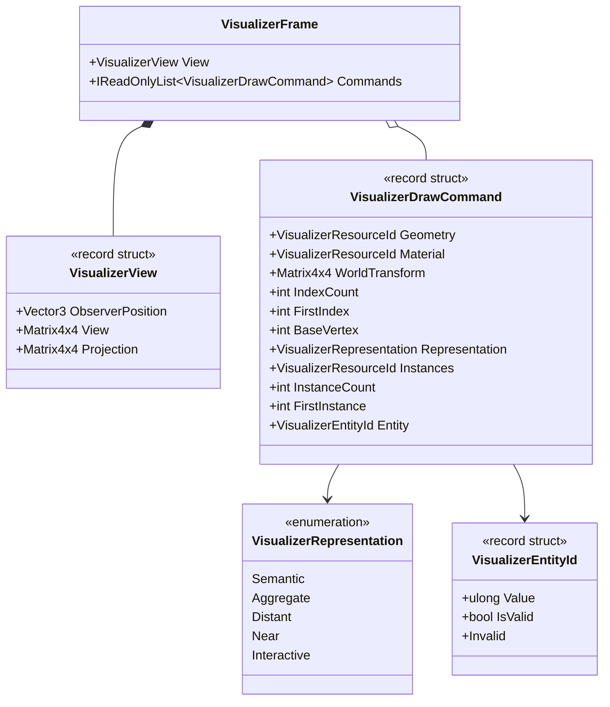

# UML — `VisualizerFrame.cs`

**Source:** [`VisualizerFrame.cs`](../../VisualizerFrame.cs)

## Responsibility

Defines the backend-neutral snapshot passed to Visualizer: view transforms, ordered indexed draw commands, representation labels, and semantic entity identity.

## Class diagram

## Observed behavior

- The constructor snapshots the incoming command sequence into an array-backed read-only list, preserving command order even if the producer later mutates or reuses its sequence.
- `VisualizerDrawCommand` rejects invalid geometry/material IDs, non-positive index/instance counts, negative range starts, and non-default instance ranges without a valid instance resource.
- `VisualizerEntityId.Value == 0` is the invalid/unassigned sentinel.
- The representation enum records the upstream Renderer choice; it does not itself perform LOD selection.

## Boundaries and non-claims

This file defines data contracts only. It does not resolve resources, choose representations, submit GPU work, or prove a presentation backend exists.
