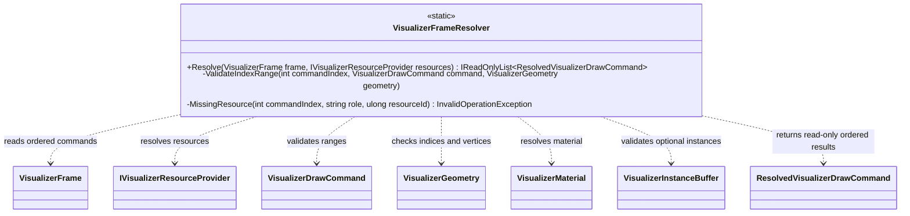

# VisualizerFrameResolver — class diagram

The resolver validates a frame against host-owned resource snapshots. It returns resolved commands in frame order and does not submit native GPU work.

## Use case

The GPU adapter resolves a CPU-side frame before native submission. Missing resources and invalid index, base-vertex, or instance ranges are rejected with command-indexed diagnostics.

## Boundary

This class is a validation/resolution boundary, not a GPU device, resource allocator, command queue, or proof of hardware execution.
