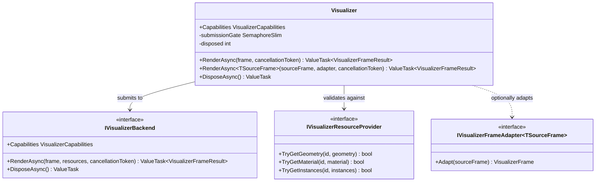

# Visualizer — UML

**Source:** [`Visualizer.cs`](../../Visualizer.cs)  
**Companion and use case:** [Visualizer.cs.md](Visualizer.cs.md)

## Structural contract

Visualizer serializes submissions, validates geometry/index/vertex/material/instance references before invoking the backend, and coordinates backend disposal after active work finishes. Pixel and GPU behavior are properties of the injected backend, not of the orchestration class itself.
