# Universe Scale Journey — Visualize / Renderer Experience Brief

**Status:** experience design and implementation plan; not yet an implemented renderer or hardware-verified scene.

> Begin outside the universe. Enter cell 42. Discover that the observer is part of the universe. Descend through the Milky Way, the Solar System, Earth, and arrive at the Workshop Moniker in motion.

[Open the animated SVG directly](assets/universe-scale-journey.svg). This is an animated storyboard to establish pacing and visual hierarchy—not yet a live 3D renderer, scientific simulation, or proof of GPU output.

This is a showcase for the Visualize + Renderer boundary: Renderer decides what matters to the observer at each scale; Visualize turns the selected representation into a continuous, compelling image. The experience must remain truthful about what is simulated, what is illustrative, and what is actually drawn.

## The emotional arc

### 00 — The Big Bang: the universe is born

Start in darkness, with the camera outside the emerging scene. A concentrated point blooms into a rapidly expanding field of luminous matter and structure. Galaxies form as visible swirls and filaments; motion should feel expansive, not like a flat particle-cloud screensaver. Sound, bloom, trails, and color grading are optional host presentation layers, not physics claims.

The opening should immediately establish depth and a recognizable center of attention. The camera stays extrinsic: it can see the whole constructed universe as an object.

### 01 — The 10 × 10 × 10 universe

Reveal a navigable universe partitioned into 1,000 logical cells. Cell outlines are initially subtle; they become legible only when useful. Camera travel transitions from the complete volume to a chosen cell, with the others still visible as context.

Cell **42** is the destination. The project must define the linear-index convention explicitly (zero-based or one-based, axis order, and coordinate origin) in scene data and documentation; never let a label conceal an ambiguous coordinate mapping.

### 02 — The threshold: observer becomes participant

As the camera arrives at cell 42, acceleration eases into a deliberate deceleration. Let the view settle. Hold the composition long enough for the viewer to understand the scale and location. Then the grid and external framing recede, the camera crosses the boundary, and the observer is revealed as *inside* the world.

This is the central dramatic beat, not just another zoom. Use a distinct transition cue—parallax, changing frame of reference, a dissolving outer grid, and a short hold—so the viewer feels the change from extrinsic overview to intrinsic observation.

### 03 — Find our galaxy

A named galaxy becomes the next focus. The rest of the large-scale universe simplifies into context rather than remaining equally detailed. The Milky Way should be recognizable as a structured spiral, not merely a bright dot with a label.

### 04 — Find the Solar System

The camera continues inward. The Sun and planets become individually legible as the representation budget permits. Do not pretend the same linear spatial scale can show both interplanetary distances and planetary surfaces in one frame; use continuous travel with controlled representational transitions and clear visual anchors.

### 05 — Earth

Earth resolves from a point into a globe, then into regional and local geography. Clouds, terrain, coastlines, and structures should appear as the observer approaches their useful detail ranges. Each new detail layer should emerge before it is needed and retire after it no longer contributes.

### 06 — The Singularity Workshop Moniker

The final approach arrives at the Workshop's living Moniker, already doing its thing. It should be the payoff: the camera stops, the motion remains alive, and the viewer has a moment to appreciate that this tiny visual destination was reached from the whole universe.

Use the real Workshop Moniker asset and its real animation where possible. Do not redraw it as a lookalike or replace it with a static placeholder without labeling the limitation.

### Optional 07 — Into the material

A later, opt-in continuation could travel through a sign reading **“The Singularity Workshop”**, into its wall, and down through material structure toward a lattice/atomic visualization. This is a separate chapter because the microscopic view is a model of material organization, not a literal camera view of atoms. Label the scientific/illustrative boundary and let viewers return to the Moniker ending without taking this detour.

## Camera and pacing

Use a scale-aware trajectory, not a single enormous world-space coordinate and not a fixed-speed lerp.

- Author named **waypoints** with position, orientation, target, desired scale/range, transition duration or pace, and a pause/hold.
- Use exponential-like approach over scale ranges, but control acceleration and deceleration so it remains navigable and does not become a nauseating velocity spike.
- Prefer a log-scale or normalized scale parameter for travel between wildly different magnitudes; interpolate orientation with a stable quaternion path and avoid abrupt camera roll.
- Add **dramatic holds** at the universe reveal, cell 42, the intrinsic/extrinsic threshold, galaxy, Solar System, Earth, and Moniker. Holds are first-class authored beats, not accidental pauses.
- Each hold must have an explicit exit condition: timed, viewer-triggered, or both. The opening experience can autoplay; a replay/skip/step-through control should make it usable as documentation.
- Preserve a stable focal anchor during representation changes. Cross-fade or morph between proxies where feasible; do not let LOD changes look like objects popping into existence.
- Support pause, resume, restart, reduced-motion pacing, and a scrub-able chapter/waypoint timeline.

## Renderer responsibilities: what should be visible?

Renderer should select observer-relative representations and work according to semantic meaning and scale. It should not own the story timeline or the GPU API.

Suggested conceptual horizons:

1. **Universe horizon:** broad structure and cell boundaries; galaxy clusters are grouped visual masses.
2. **Cell horizon:** cell 42 and nearby cells gain structure; distant cells remain contextual.
3. **Galaxy horizon:** galaxy silhouette, spiral arms, and major luminous regions.
4. **Stellar horizon:** star systems and orbital relationships.
5. **Planetary horizon:** globe, atmosphere, terrain, and regional features.
6. **Local horizon:** buildings, sign, Moniker.
7. **Material horizon (optional):** sign/wall layers and a clearly marked material lattice model.

These are semantic policies, not fixed distances baked into Visualize. Thresholds should account for projected size, observer motion, available time budget, and whether the object contributes to the current beat. Hysteresis and transition bands should prevent oscillation at boundaries.

## Visualize responsibilities: how does it become pixels?

Visualize consumes the selected representation and executes it through the active backend. Keep the experience's story data separate from the rendering API.

- Reuse immutable geometry/material/instance resources and revision-aware resource plans; avoid creating a unique managed object for every particle.
- Prefer contiguous arrays, instancing, compact IDs, and batched uploads over per-object CPU submission.
- Use GPU compute for workloads only where the selected backend and measured workload justify it; keep a deterministic CPU reference path for validation and portability.
- Separate simulation/update cadence from presentation cadence. Distant structure can update slowly; close motion and camera-critical geometry need finer cadence.
- Separate environment, stellar/galactic structure, constructs, atmosphere, and local animated Moniker into independently schedulable buckets.
- Use camera-relative coordinates, hierarchical local coordinate frames, or equivalent high/low precision techniques as needed. Do not rely on a single float coordinate system spanning cosmic and microscopic scales.
- Keep the host responsible for surface/window lifecycle. Keep Renderer backend-neutral. Keep Visualize core backend-neutral; native API details belong in an isolated GPU adapter.

## Millions and billions: represent the information, not necessarily one object per thing

The target is an experience that can communicate extreme populations without one managed object, one draw call, or one separately addressable pixel per item.

- **Exact individuals nearby:** use real geometry/instances when the observer can distinguish them.
- **Instanced populations:** represent repeated stars, particles, debris, or other objects with compact instance records and shared geometry/materials.
- **Aggregated populations:** far away, represent millions of objects as density fields, point distributions, clustered volumes, or statistical summaries.
- **Procedural fields:** generate repeatable structure from seeds and bounded regions instead of retaining every distant object's full state.
- **Progressive refinement:** replace an aggregate with more detail as the camera approaches, preserving spatial distribution and visual continuity.
- **Budget and report:** track candidate count, visible count, instances submitted, bytes transferred, CPU preparation, GPU execution, synchronization, and presentation separately.

A “billion objects” claim must state what an object means. One billion individually simulated rigid bodies is a different problem from a billion procedurally represented points or a density field that visually implies that population. The scene should offer a meaningful population stress mode, but must not claim a billion individual pixels or independently simulated entities unless that is what the implementation measures.

## Scene data and repeatability

The journey should be data-authored and deterministic enough to reproduce:

- A versioned journey manifest identifies waypoints, pauses, coordinate frames, semantic subjects, and transitions.
- Procedural populations use explicit seeds and stable region identities.
- Cell 42 uses an explicit index-to-coordinate rule.
- Scene assets and generated workload data record revisions and, where useful, hashes.
- A replay can reproduce the same camera route and population seeds for visual regression captures.
- Keep user interaction and presentation effects separate from the canonical scene state so the journey can be paused, scrubbed, and tested.

## First vertical slice

Build the smallest real, reviewable slice before attempting the full universe:

1. A 10 × 10 × 10 cell volume with explicit index convention and a visually distinguished cell 42.
2. A camera waypoint sequence from outside the volume to cell 42, including exponential-like approach, controlled deceleration, and a dramatic hold.
3. A visible intrinsic/extrinsic transition: the external grid/framing recedes and the camera resumes travel from inside the selected cell.
4. Renderer supplies observer-relative representation changes; Visualize draws them through an existing, verified path.
5. A real Moniker asset/animation is the first concrete final destination, even if galaxy/Solar System/Earth are initially scale-transition proxies.
6. A repeatable capture and documented evidence boundary.

Then add the galaxy → Solar System → Earth transitions and progressively replace proxies with richer representations. The optional wall/material dive comes last.

## Acceptance evidence

Do not call the whole journey complete merely because a browser mock-up animates or a project compiles.

- **Contract-tested:** camera waypoints, index mapping, pause/hold behavior, and representation-selection decisions have automated tests.
- **Visual proof:** deterministic captures show cell 42, the intrinsic transition, and the real Moniker endpoint.
- **Backend proof:** the documented Visualize path renders the scene through the identified backend and host surface.
- **Hardware-verified:** record the device/backend/runtime, confirm actual pixel output, exercise resize/restart/disposal, and preserve logs or captures.
- **Performance evidence:** report scene scale, what each entity represents, population counts, frame-time distribution, CPU/GPU/upload/sync measurements, and machine/runtime configuration.

A browser-only SVG/WebGPU prototype may help develop pacing and storyboards, but it must be labeled as a browser experiment unless it genuinely consumes the C# Visualize path.

## Working principle

**Scale changes what we can afford to represent; it must not change who owns the world.** Renderer decides what is relevant to this observer. Visualize executes the chosen presentation. The Experience owns the journey, meaning, and authored pauses. The Moniker is the destination—and the universe-scale trip is the proof that these boundaries can cooperate.
