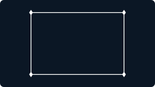
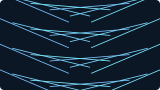
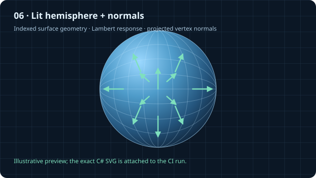

# Primitive Gallery — Visual Test Sequence 01

This is a browser-run visual experiment for the first drawing primitives. It uses inline SVG and JavaScript, with no external assets, build step, graphics library, or server API.

## Generate the visible proof with Visualize

The checked-in pictures in steps 01–05 are emitted by the C# `Visualizer` path—not hand-authored SVG lookalikes. Step 06 extends that proof to a lit hemisphere and normal vectors. The preview below makes the result visible here; the exact SVG emitted by the latest successful development CI run is available in the linked artifact. The proof harness registers actual `VisualizerGeometry`, `VisualizerMaterial`, and `VisualizerInstanceBuffer` resources, constructs `VisualizerFrame` draw commands, and submits them through `Visualizer.RenderAsync` to a small SVG output backend. That backend translates the submitted indexed triangles into SVG paths.

From the repository root, run:

```powershell
dotnet run --project samples/PrimitiveGallery/VisualizeSvgProof/VisualizeSvgProof.csproj
```

The harness writes the SVG files into `samples/PrimitiveGallery/generated/`. The checked-in SVG snapshots below are compacted from successful harness output so GitHub can render the evidence directly in this README—no second browser or JavaScript demo is needed to see the results. Re-run the harness after changing the backend and review the refreshed files before updating the snapshots.

## Progression and expected observations

| Step | Generated output | What the image demonstrates |
| --- | --- | --- |
| 01 · One point |  | A small diamond marker made from indexed triangles is submitted through a Visualizer frame. This is a mesh-backed point marker, not a native point-list primitive. |
| 02 · Point cloud |  | One marker mesh is submitted with 100 transforms/tints in a contiguous instance buffer. |
| 03 · Four connected points |  | Four marker draws and four segment-mesh draws form a closed outline. The C# SVG backend adds a moving trace marker and dash animation over the submitted geometry, making this the first living output in the contract-backed sequence. The geometry is emitted by Visualizer; the overlay is SVG presentation animation, not an FSM update loop. |
| 04 · One line |  | A thin rectangle made from two triangles is transformed and submitted as a line-like segment. |
| 05 · Many lines |  | One segment mesh is submitted across 24 instance transforms. |
| 06 · Lit hemisphere + normals | <br> [Download the exact SVG from successful CI run #447](https://github.com/TrentBest/TheSingularityWorkshop.Visualize/actions/runs/38454948993/artifacts/11842082589) | A tessellated hemisphere is submitted as indexed geometry; the SVG proof backend computes a simple Lambert response from its vertex normals and overlays projected normal vectors. This is a backend lighting study, not a production shader. The preview is a documentation illustration; the CI artifact contains the exact output produced by the C# harness. |

## Follow the colored API trail

[Open the [living SVG + color-coded code view](api-consumption.html)](api-consumption.html). The README above already shows the SVG; this companion lays the output beside the source path.

- 🟦 **Scene contract data** — the C# code creates geometry, material resources, and a `VisualizerFrame`.
- 🟩 **API consumption** — `new Visualizer(...)` and `await visualizer.RenderAsync(example.Frame)` submit that frame through the public Visualize API.
- 🟨 **SVG presentation** — the proof backend adds the moving marker and dashed trace after receiving the frame. This animation is SVG-specific; it is not an FSM update loop.

The exact call site is in [VisualizeSvgProof/Program.cs](VisualizeSvgProof/Program.cs); the backend implementation is in the same file. The new [GUI.SVG adapter](https://github.com/TrentBest/TheSingularityWorkshop.GUI/tree/development/src/SVG) is a separate initial adapter project; it is **not yet wired into this proof backend**. The next integration step is to replace this proof backend's own SVG serialization with the reusable GUI.SVG manifestation layer without changing the Visualizer contract.

The proof backend is intentionally small and is not a production GPU backend. It does, however, consume the same Visualizer frame/resource contracts and draw commands that the current C# implementation validates. Its SVG output is an inspectable backend result, not an independently drawn HTML demo. Step 06 adds a deliberately simple backend-side Lambert calculation and normal-vector overlay so we can inspect actual indexed surface geometry and its normals. It does not mean lighting is already part of the production Visualizer material contract. The current Visualizer contract has indexed triangle draws, not native point or line-list topology, so points and lines here are represented by tiny triangle meshes.

## Keep the two experiments distinct

The interactive [`index.html`](index.html) page still generates its own SVG marks in browser JavaScript. Its sliders, randomization, and build-time counter are useful for interaction experiments, but they are **not** driven by the C# assembly. The C#-generated files above are the separate backend-contract proof. Keeping that distinction visible is part of the test: an attractive browser drawing is not evidence that the C# path rendered it.

## What the counters measure

- **Visible marks** counts the generated primitive marks in the scene.
- **SVG elements created** currently reports those generated marks; the fixed background grid and axes are not included.
- **Build time** is the local JavaScript generation and SVG DOM-insertion pass, measured with `performance.now()`.

The interactive page is a visual experiment, not yet an automated rendering test for the C# Visualize contracts. The .NET test project currently verifies resource catalog behavior, geometry/index validity, draw and instance ranges, backend submission safety, and disposal. It does not run this SVG page. The build-time number is not a GPU timing, a cross-device benchmark, or a performance claim.

The next progression should be derived from the actual C# contract tests and the drawing capabilities that are implemented, adding assertions and visible examples together rather than documenting planned primitives as if they already exist.

## Replay an actual FSM_API run

Open `samples/PrimitiveGallery/fsm-trace-replay.html` locally from your Visualize checkout. It loads JSON snapshots exported by the C# [SimpleDemos](https://github.com/TrentBest/SimpleDemos) console app. Run its `--export-trace` mode, then select the resulting JSON file in the replay page. The page maps recorded agent positions and labels to the recorded FSM states; it does not execute FSM_API or synthesize missing frames. This is the first file-based bridge from real FSM execution to a living documentation visual, while keeping the simulation and renderer responsibilities separate.

## Next visual experiment

Continue with [Surface Normals & Light](../NormalLightingLab/index.html): move the light direction, vary ambient and diffuse contributions, and toggle the projected normal vectors while the SVG scene updates live. Its [guide](../NormalLightingLab/README.md) explains the model and its boundaries.
