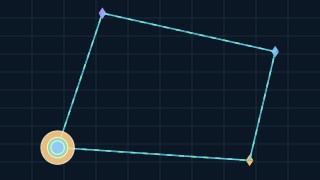

# Primitive Gallery — Visual Test Sequence 01

This is a browser-run visual experiment for the first drawing primitives. It uses inline SVG and JavaScript, with no external assets, build step, graphics library, or server API.

## Generate the visible proof with Visualize

The checked-in pictures in steps 01–05 are emitted by the C# `Visualizer` path—not hand-authored SVG lookalikes. Step 06 is a documentation preview of the C# lighting/normal study; its exact generated SVG is linked in the table. Step 07 is a second backend path: Visualizer submits the same kind of geometry/resource frame, `GuiSvgVisualizerBackend` maps its indexed triangles to neutral GUI nodes, and `TheSingularityWorkshop.GUI.SVG` emits the SVG document. Both backend outputs are generated in development CI. The GUI.SVG feature gallery is generated from its C# scene builder, byte-compared with the checked-in GUI snapshot, and bundled with the adapter guide in the GUI.SVG package. The GUI.SVG path is a 2D manifestation proof, not a production perspective/depth-tested renderer.

From the repository root, run:

```powershell
dotnet run --project samples/PrimitiveGallery/VisualizeSvgProof/VisualizeSvgProof.csproj
```

The harness writes the SVG files into `samples/PrimitiveGallery/generated/`. The checked-in SVG snapshots below are compacted from successful harness output so GitHub can render the evidence directly in this README—no second browser or JavaScript demo is needed to see the results. Re-run the harness after changing the backend and review the refreshed files before updating the snapshots.

## Progression and expected observations

| Step | Generated output | What the image demonstrates |
| --- | --- | --- |
| 01 · One point |  | A small diamond marker made from indexed triangles is submitted through a Visualizer frame. This is a mesh-backed point marker, not a native point-list primitive. |
| 02 · Point cloud |  | One marker mesh is submitted with 100 transforms/tints in a contiguous instance buffer. |
| 03 · Four connected points |  | Four colored marker draws and four segment-mesh draws form an irregular outline. The C# proof backend adds a dashed trace and three staggered motion markers along an explicitly closed path. The geometry is emitted by Visualizer; the trail is SVG presentation animation, not an FSM update loop. |
| 04 · One line |  | A thin rectangle made from two triangles is transformed and submitted as a line-like segment. |
| 05 · Many lines |  | One segment mesh is submitted across 24 instance transforms. |
| 06 · Lit hemisphere + normals | <br> [Download the exact SVG from successful CI artifact](https://github.com/TrentBest/TheSingularityWorkshop.Visualize/actions/runs/38474869478/artifacts/11853243532) | A tessellated hemisphere is submitted as indexed geometry; the SVG proof backend computes a simple Lambert response from its vertex normals and overlays projected normal vectors. This is a backend lighting study, not a production shader. |
| 07 · GUI.SVG integration |  | The optional Visualize integration backend consumes the public Visualizer frame/resource contracts, translates the four colored point meshes and four segment meshes into GUI nodes, then asks `SvgGuiRenderer` to emit SVG. The dashed route and three moving markers are explicit SVG animation nodes; the route returns explicitly to its starting point so the loop has no position reset jump. |
| 08 · Perspective-projected mesh | [Open the CI-generated SVG artifact](https://github.com/TrentBest/TheSingularityWorkshop.Visualize/actions/runs/38489100975) | An indexed octahedron passes through the public geometry/material/draw/frame contracts. The proof applies world, view, and perspective projection matrices before emitting the SVG. It uses painter ordering for this convex opaque mesh; it is not GPU depth testing or a production renderer. |
| 09 · GUI.SVG feature gallery | [Open the CI-generated SVG artifact](https://github.com/TrentBest/TheSingularityWorkshop.Visualize/actions/runs/38489100975) | The reusable GUI.SVG renderer manifests gradients, clipping, patterns, markers, symbol reuse, animation, procedural filter graphs, and lighting definitions from a C# scene builder. The SVG is generated during CI and included in the proof artifact, not maintained as a hand-authored lookalike.

## Follow the colored API trail

Open the [living SVG + color-coded code view](api-consumption.html). It shows the GUI.SVG-generated output beside the exact source path.

- 🟦 **Scene contract data** — geometry, per-point materials, segment draws, and a `VisualizerFrame`.
- 🟩 **API consumption** — `new Visualizer(...)` and `await visualizer.RenderAsync(frame)`.
- 🟨 **GUI.SVG manifestation** — the backend builds neutral GUI nodes and calls `SvgGuiRenderer.Render(scene.Build())`; the route and marker trail are explicit SVG animation nodes.

The proof program is [integrations/GuiSvg/Proof/Program.cs](../../integrations/GuiSvg/Proof/Program.cs); the backend is [integrations/GuiSvg/GuiSvgVisualizerBackend.cs](../../integrations/GuiSvg/GuiSvgVisualizerBackend.cs), and the reusable package source is in the [GUI repository](https://github.com/TrentBest/TheSingularityWorkshop.GUI/tree/development/src/SVG). CI checks the integration out from the GUI repository's `development` branch and tests it. The package is not published, and the NuGet publishing workflow remains disabled.

The proof backend is intentionally small and is not a production GPU backend. It does, however, consume the same Visualizer frame/resource contracts and draw commands that the current C# implementation validates. Its SVG output is an inspectable backend result, not an independently drawn HTML demo. Step 06 adds a deliberately simple backend-side Lambert calculation and normal-vector overlay so we can inspect actual indexed surface geometry and its normals. It does not mean lighting is already part of the production Visualizer material contract. The current Visualizer contract has indexed triangle draws, not native point or line-list topology, so points and lines here are represented by tiny triangle meshes.

## Keep the two experiments distinct

The interactive [`index.html`](index.html) page still generates its own SVG marks in browser JavaScript. Its sliders, randomization, and build-time counter are useful for interaction experiments, but they are **not** driven by the C# assembly. The C#-generated files above are the separate backend-contract proof. Keeping that distinction visible is part of the test: an attractive browser drawing is not evidence that the C# path rendered it.

## What the counters measure

- **Visible marks** counts the generated primitive marks in the scene.
- **SVG elements created** currently reports those generated marks; the fixed background grid and axes are not included.
- **Build time** is the local JavaScript generation and SVG DOM-insertion pass, measured with `performance.now()`.

The interactive page is a visual experiment, not yet an automated rendering test for the C# Visualize contracts. The .NET test project currently verifies resource catalog behavior, geometry/index validity, draw and instance ranges, backend submission safety, and disposal. It does not run this SVG page. The build-time number is not a GPU timing, a cross-device benchmark, or a performance claim.

The next progression should be derived from the actual C# contract tests and the drawing capabilities that are implemented, adding assertions and visible examples together rather than documenting planned primitives as if they already exist.

## Replay an actual FSM_API run

Open `samples/PrimitiveGallery/fsm-trace-replay.html` locally from your Visualize checkout. It loads JSON snapshots exported by the C# [SimpleDemos](https://github.com/TrentBest/SimpleDemos) console app. Run its `--export-trace` mode, then select the resulting JSON file in the replay page. The page maps recorded agent positions and labels to the recorded FSM states; it does not execute FSM_API or synthesize missing frames. This is the first file-based bridge from real FSM execution to a living documentation visual, while keeping the simulation and renderer responsibilities separate.

## Next visual experiment

Continue with [Surface Normals & Light](../NormalLightingLab/index.html): move the light direction, vary ambient and diffuse contributions, and toggle the projected normal vectors while the SVG scene updates live. Its [guide](../NormalLightingLab/README.md) explains the model and its boundaries.

---

<p align="center">
  <a href="https://github.com/TrentBest/TheSingularityWorkshop" aria-label="The Singularity Workshop living avatar">
    
  </a><br />
  <strong>The Singularity Workshop</strong><br />
  <em>If a picture is worth a thousand words, what is a living picture worth?</em><br />
  <a href="https://github.com/TrentBest">GitHub</a> · <a href="https://www.patreon.com/TheSingularityWorkshop">Support the Workshop</a>
</p>
